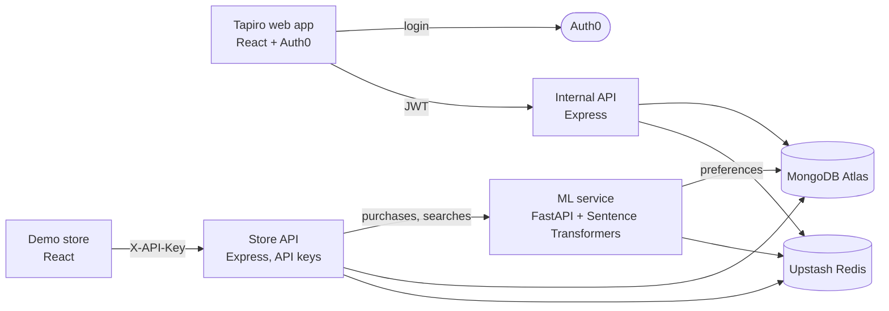

# Tapiro

Tapiro builds a preference profile for each shopper from the purchases and searches that stores send it, lets the shopper see and control that profile, and gives stores an API to use it for recommendations.

**Live demo:** LIVE_URL_PENDING
**Demo store:** DEMO_STORE_URL_PENDING

Press "Log in as demo user" or "Log in as demo store" on the home page. The logins are listed there too. Demo data resets every night.


## How it works



1. A store sends purchases and searches to the Store API with its API key.
2. The ML service matches each item to a category in the taxonomy (`ml-service/app/data/taxonomy.yaml`) using `all-MiniLM-L6-v2` embeddings, then updates the shopper's preference scores.
3. The shopper logs in to the web app to see their profile, turn data sharing on or off, and block individual stores.
4. Stores read preferences back through the Store API, but only for shoppers who allow it.

Store API docs: [authentication](authentication.md), [data submission](data_submission.md), [preference retrieval](preference_retrieval.md), [taxonomy](taxonomy.md).

## Run it locally

You need Docker and an Auth0 tenant (the free plan works). `.env.example` lists what to set up in Auth0.

```bash
git clone https://github.com/CDevmina/Tapiro.git && cd Tapiro
cp .env.example .env   # fill in the Auth0 values and AI_SERVICE_API_KEY
docker compose up --build
```

- Web app: http://localhost:5173
- Demo store: http://localhost:5174
- Internal API docs: http://localhost:3000/docs
- Store API docs: http://localhost:3001/docs

To load the demo user, demo store and sample shopping data:

```bash
docker compose exec \
  -e DEMO_STORE_API_KEY=$(openssl rand -hex 32) \
  -e DEMO_USER_PASSWORD=pick-one -e DEMO_STORE_PASSWORD=pick-one \
  tapiro-api-internal npm run seed:demo
```

The script creates the two demo users in your Auth0 tenant. Add `-e SKIP_AUTH0=1` to load only the MongoDB data.

## Stack

- Frontend: React 19, Vite, Tailwind CSS, Flowbite, Auth0
- APIs: Node.js 20, Express, oas3-tools (OpenAPI 3.0)
- ML: Python 3.11, FastAPI, Sentence Transformers (`all-MiniLM-L6-v2`, CPU)
- Data: MongoDB, Redis
- Hosting: Azure Container Apps, Azure Static Web Apps, MongoDB Atlas, Upstash
- CI/CD: GitHub Actions builds the images, deploys on every push to `Development` and re-seeds the demo nightly
